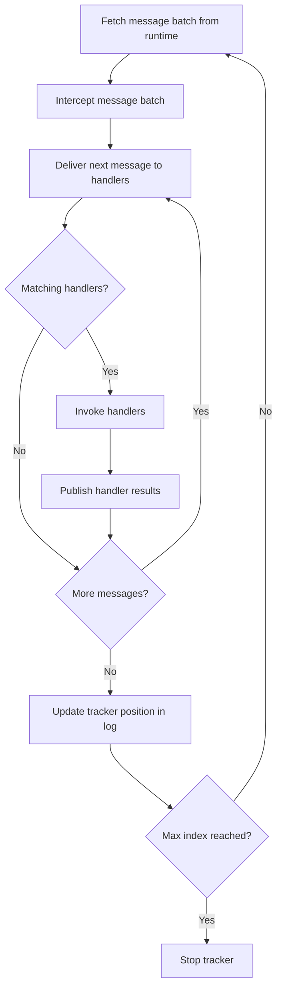
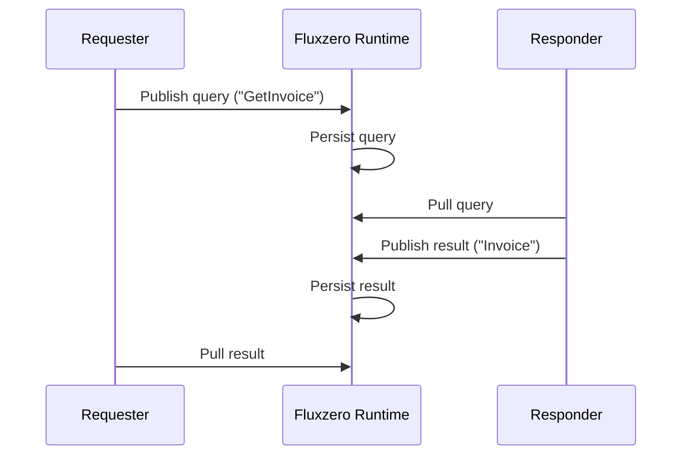

import Jdoclink from '~/components/jdoclink.astro';

import { Tabs, TabItem } from '@astrojs/starlight/components';

Tracking lets your application consume messages from Runtime logs and resume from its saved position. **Consumers**, **trackers**, and **handlers** divide that work:

- **Consumers** define a named subscription to a message type (commands, events, queries, etc.). Each consumer has its own position in the log and its own configuration (threads, fetch size, backpressure strategy).
- **Trackers** are the worker threads belonging to a consumer. A tracker fetches batches of messages from the Runtime and delivers them to handler methods. Multiple trackers per consumer enable parallelism.
- **Handlers** functionally process messages using annotated methods like `@HandleCommand`. You can configure which handlers belong to which consumers.

This separation makes Fluxzero highly flexible: you can isolate workloads into dedicated consumers, scale them independently, or run multiple consumers side by side in the same application.

## Custom Consumers with @Consumer

The `@Consumer` annotation creates or selects a named consumer that runs independently of other consumers. Each consumer maintains its own trackers and log position. This lets you:

- Isolate heavy or latency-sensitive message flows into their own consumer.
- Tune concurrency (via `threads`) and throughput (via `maxFetchSize`) separately.
- Deploy multiple consumers side by side in the same app, each with dedicated resources.

<Tabs>
<TabItem value="Java" label="Java">

```java
@Consumer(name = "activity-log")
class ActivityLogger {
    @HandleEvent
    void handle(CompleteTask event) {
        log.info("Completed task {}", event.taskId());
    }
}
```

</TabItem>
<TabItem value="Kotlin" label="Kotlin">

```kotlin
@Consumer(name = "activity-log")
class ActivityLogger {
    @HandleEvent
    fun handle(event: CompleteTask) {
        log.info("Completed task {}", event.taskId)
    }
}
```

</TabItem>
</Tabs>

To apply this to an entire package (and its subpackages), add a `package-info.java` file:

```java
@Consumer(name = "activity-log")
package com.example.handlers;
```

## Default Consumer Behavior

Handlers without an explicit `@Consumer` or matching custom `ConsumerConfiguration` are assigned according to the
configured unconfigured-handler consumer mode. If no mode is configured explicitly, `fluxzero.defaults.version`
selects the default behavior.

For defaults versions `2026.07.27` and newer, the default behavior is `perPackage`:

```properties
fluxzero.defaults.version=2026.07.27
# equivalent explicit setting:
fluxzero.tracking.unconfiguredHandlerConsumerMode=perPackage
```

With this defaults version, Fluxzero creates one default consumer per exact handler package and message type. Loose
commands in the same package can therefore share a consumer without a marker interface. The generated consumer uses
the default consumer configuration for the message type as its template.

Defaults versions from `2026.05.20` through `2026.07.26` retain the `perHandler` default. Applications without
`fluxzero.defaults.version`, or with an older defaults version, retain the original shared application consumer. All
three behaviors can be selected explicitly:

```properties
fluxzero.tracking.unconfiguredHandlerConsumerMode=perPackage
# or
fluxzero.tracking.unconfiguredHandlerConsumerMode=perHandler
# or
fluxzero.tracking.unconfiguredHandlerConsumerMode=defaultAppConsumer
```

For example:

<Tabs>
<TabItem value="Java" label="Java">

```java
class ActivityLogger {
    @HandleEvent
    void handle(CompleteTask event) {
        log.info("Completed task {}", event.taskId()); here
    }
}
```

</TabItem>
<TabItem value="Kotlin" label="Kotlin">

```kotlin
class ActivityLogger {
    @HandleEvent
    fun handle(event: CompleteTask) {
        log.info("Completed task {}", event.taskId) here
    }
}
```

</TabItem>
</Tabs>

With `perPackage`, handlers in the same exact package share a generated consumer. With `perHandler`, this handler gets
its own generated consumer. With `defaultAppConsumer`, it joins the shared default consumer. A matching builder
configuration is used before the fallback, while an explicit `@Consumer` remains most specific.

The practical difference is the isolation boundary: package, handler class, or application. Automatic model command
handling follows the same selection rules as an explicit command handler and therefore also uses a consumer configured
for the command payload package, including a root-package `@Consumer`.

An absolute HTTP URL does not select a separate consumer. In tests, give blocking external-service stubs
an explicit consumer while preserving application consumer configuration; see
[HTTP stubs and consumers](/docs/guides/messaging/testing-web-endpoints/#external-http-stubs-and-consumers).
## Namespaces

Namespaces isolate message logs and tracking state, so a single Fluxzero Runtime can host multiple environments
(for example `test`, `accept`, and `staging`) without clashing data.

- Set `FLUXZERO_NAMESPACE` (env var or property) to define the app's default namespace. This applies across subsystems
  (messaging, tracking, documents/search, event store, and related runtime operations).
- If no namespace is configured, the runtime default namespace is used.
- You can still set a namespace on `@Consumer(namespace = "...")` or via `ConsumerConfiguration.namespace(...)` for
  consumer-specific cross-namespace flows (for example, peeking/replaying from another namespace).

### Discovering namespaces

Use the application's `Client` to retrieve existing namespaces in the connected Runtime:

<Tabs>
<TabItem value="Java" label="Java">

```java
CompletableFuture<List<String>> namespaces = fluxzero.client().getNamespaces();
```

</TabItem>
<TabItem value="Kotlin" label="Kotlin">

```kotlin
val namespaces: CompletableFuture<List<String>> = fluxzero.client().getNamespaces()
```

</TabItem>
</Tabs>

The result is sorted and contains each namespace once, including namespaces without active clients. It covers
both Runtime databases when search uses separate storage. Asking for the overview does not create a namespace.
The list is a momentary inventory of the whole Runtime environment, not an authorization list or a list of active apps.
Only Fluxzero-owned schemas qualify; unrelated database schemas and other applications' Flyway schemas are excluded.

This operation requires a Runtime supporting the `/namespaces` WebSocket endpoint and a deployment route that
permits access to this environment-wide inventory. Older Runtimes do not support it. `LocalClient` returns the
namespaces created within that root client; Test Server returns its initialized namespaces. Both local inventories
last only as long as their in-memory environment. Custom `Client` implementations can override `getNamespaces()`;
the default implementation fails with `UnsupportedOperationException`.

## Customizing consumer configuration

You can also tune the behavior using additional attributes on the `@Consumer` annotation:

<Tabs>
<TabItem value="Java" label="Java">

```java
@Consumer(name = "activity-log", threads = 2, maxFetchSize = 100)
class ActivityLogger {
    @HandleEvent
    void handle(CompleteTask event) {
        log.info("Completed task {}", event.taskId());
    }
}
```

</TabItem>
<TabItem value="Kotlin" label="Kotlin">

```kotlin
@Consumer(name = "activity-log", threads = 2, maxFetchSize = 100)
class ActivityLogger {
    @HandleEvent
    fun handle(event: CompleteTask) {
        log.info("Completed task {}", event.taskId)
    }
}
```

</TabItem>
</Tabs>

- `threads = 2`: Two threads per application instance will fetch commands.
- `maxFetchSize = 100`: Up to 100 messages fetched per request, helping apply backpressure.

Each thread runs a **tracker**. If you deploy the app multiple times, Fluxzero automatically load-balances messages across all available trackers.

## Changing consumer ownership

Use [Split a consumer](/docs/guides/messaging/splitting-a-consumer) to give a handler its own progress, or
[Merge two consumers](/docs/guides/messaging/merging-consumers) to bring handlers together.
Both guides preserve existing backlog with a fixed index boundary.
For a parallel correction run, see [live and historical processing](/docs/guides/messaging/live-and-historical-processing).

## Consumer settings

Fluxzero provides conservative defaults to ensure safe and sequential processing:

| Setting                | Description | Default value             |
|------------------------|-------------|---------------------------|
| `awaitAsyncResults`    | If true, waits for asynchronous handler results before finishing the batch. | `false`                   |
| `awaitOutgoingWrites` | If true, waits for outgoing command completions before storing position. | `true`                    |
| `batchInterceptors`    | Batch processing interceptors for this consumer. | `{}`                      |
| `clientControlledIndex` | If true, the app decides which messages to process. | `false`                   |
| `dispatchInterceptors` | Dispatch interceptors active while this consumer handles a batch. | `{}`                      |
| `durationUnit`         | Time unit for `maxWaitDuration`. | `SECONDS`                 |
| `errorHandler`         | Logs processing errors and continues. | `LoggingErrorHandler`     |
| `exclusive`            | Handlers are active in only one consumer. | `true`                    |
| `exclusiveAfterMaxIndex` | If true, keeps exclusivity after `maxIndexExclusive` is reached. | `true`                    |
| `exclusiveBeforeMinIndex` | If true, keeps exclusivity before `minIndex` is reached. | `true`                    |
| `filterMessageTarget`  | If true, only messages targeted to this instance are processed. | `false`                   |
| `flowRegulator`        | Default backpressure strategy; no throttling. | `NoOpFlowRegulator`       |
| `handlerInterceptors`  | Handler invocation interceptors for this consumer. | `{}`                      |
| `ignoreSegment`        | If true, bypasses Runtime sharding and processes all segments. | `false`                   |
| `maxFetchBytes`        | Serialized payload byte limit per fetch; `-1` inherits the global default. | `-1`                      |
| `maxFetchSize`         | Maximum messages per batch; balances throughput and memory. | `1024`                    |
| `maxIndexExclusive`    | Negative means no upper bound. | `-1`                      |
| `maxWaitDuration`      | Maximum idle wait; omitted values inherit application configuration. | `15 minutes on supporting peers`                      |
| `minIndex`             | Negative means start at the end of the log (only new messages). | `-1`                      |
| `namespace`            | Namespace for this consumer; empty uses the client default. | `""` (empty)              |
| `passive`              | If true, handler results are ignored and not published to the result log. | `false`                   |
| `singleTracker`        | If true, a single tracker processes all messages in strict global order. | `false`                   |
| `storePositionManually` | If true, the app must commit tracker position explicitly. | `false`                   |
| `threads`              | Number of tracker threads. Each thread owns a disjoint segment of the log. | `1`                       |
| `typeFilter`           | No server-side filtering; all message types are delivered. | `""` (empty)              |

## Consumer error handling

### Start with the default

**Start with `LoggingErrorHandler`, the consumer default.** It logs technical failures at error level and functional
failures at warning level, returns the error, and lets tracking continue without retrying. No explicit `errorHandler`
setting is needed. A normally completed batch can advance its position past a failed effect: monitor failures and
provide reconciliation or replay where needed. Select another policy when those recovery requirements demand it.

```java
@Consumer(name = "item-projection") // LoggingErrorHandler is the default
final class ItemProjection {
    // tracked handlers
}
```

```kotlin
@Consumer(name = "item-projection") // LoggingErrorHandler is the default
class ItemProjection {
    // tracked handlers
}
```

### Beware of stopping instead of retrying

**`ThrowingErrorHandler` does not retry or automatically resume. It can stop the affected tracker until explicit
restart, typically application restart or redeployment after repair.** Even an ordinary `FunctionalException` can
stop it. Other trackers or application instances may continue; this is not a global pause of the consumer.

Choose this only when stopping for operator intervention is deliberate, with an alert and a repair/restart procedure.
For a message failure with a known index and automatic position storage, the tracker can store progress before that
index and then stop. Already completed effects are not rolled back and can repeat during recovery. A temporary outage
by itself is not a reason to select this policy if automatic retry is the intended recovery.

### Choose a built-in policy deliberately

| Policy | Behavior | Suitable boundary |
| --- | --- | --- |
| `LoggingErrorHandler` | log and continue without retry | recommended starting point; continued failures are observable and recoverable if needed |
| `RetryingErrorHandler` | default: up to five retries, then continue; configurable stop | bounded recovery from transient failures, with repeatable effects |
| `ForeverRetryingErrorHandler` | no retry-count limit for eligible failures | recoverable failures must hold up progress; idempotent effects, lag alerts and operator recovery |
| `ThrowingErrorHandler` | rethrow immediately and stop the affected tracker | deliberate operator-controlled stop with explicit restart |
| `SilentErrorHandler` | continue without retry, with configurable or no logging | deliberately best-effort work with separate observability |

### When unlimited retries fit

Use `ForeverRetryingErrorHandler` when skipping an effect during a recoverable outage is unacceptable, repeating the
operation is safe, and delaying subsequent processing is acceptable. Examples are replacing a document by stable ID
or reconciling schedules from durable current intent. This is an explicit per-consumer choice:

```java
@Consumer(name = "reconciled-projection", errorHandler = ForeverRetryingErrorHandler.class)
final class ReconciledProjection {
    // idempotent tracked effects; alert on sustained lag and failures
}
```

```kotlin
@Consumer(name = "reconciled-projection", errorHandler = ForeverRetryingErrorHandler::class)
class ReconciledProjection {
    // idempotent tracked effects; alert on sustained lag and failures
}
```

The first retry is immediate. After failed retries, the default backoff starts at 10 seconds and caps at one minute.
While retries continue, the affected tracker/batch waits. A permanent bug or poison message can block it indefinitely;
monitor lag and provide operational repair. This is neither an exactly-once guarantee nor a guarantee that every error
will be retried until success.

Both retry handlers exclude an **initial** `FunctionalException` by default and let processing continue. That filter
is checked when entering error handling, not on every retry. Later failures use `RetryConfiguration.errorTest`, which
excludes `Error` by default; a later functional failure can therefore keep retrying. Interruption or a rejected retry
failure can end an unlimited loop. A rejected retry failure returns `null` by default; interruption normally returns
the mapped original error. Custom policy code can also throw. Do not use unlimited retry for deterministic business rejection or non-idempotent external effects.

Use `ConsumerConfiguration.errorHandler(...)` through application bootstrap when a retry filter, delay, maximum,
error mapping, or final stop/continue choice needs a configured instance. `RetryingErrorHandler` defaults to an
immediate first retry and two-second delays after failed retries. With `stopConsumerOnFailure = true`, exhausted
**or initially excluded** failures can stop tracking until explicit restart.

A retry can repeat a complete handler or batch, depending on the failure boundary. Effects completed before the
failure are not rolled back. Waiting for asynchronous work is a separate choice: `awaitOutgoingWrites` defaults to
`true`, while `awaitAsyncResults` defaults to `false`. The selected error policy still decides whether a surfaced
failure causes retry, continuation or stop. Test this through an asynchronous `TestFixture`, including effect-attempt
counts and tracker positions, rather than only calling the error handler directly.

## Custom routing keys

By default, Fluxzero uses **128 segments** to balance parallelism and ordering guarantees. These segments are evenly split across available trackers to distribute load efficiently. The `ignoreSegment` configuration, when set to `true`, means that each tracker receives all messages regardless of segment assignment. This enables handler-level routing control with custom routing keys when segment-based assignment is not sufficient. The `singleTracker` option can be enabled to force all segments to be managed by a single tracker instance, simplifying ordering at the cost of scalability.

To override routing using a custom routing key at handler level, annotate your handler class with `@Consumer(name = "...", ignoreSegment = true)`. Then, use the `@RoutingKey` annotation on your handler method (or class) to specify which field to use for routing.

<Tabs>
  <TabItem value="java" label="Java">

```java
@Consumer(name = "order-processor", ignoreSegment = true)
class OrderProcessor {
    @HandleCommand
    @RoutingKey("paymentId")
    void handle(SubmitOrder command) {
        // Handler logic here, routing messages by paymentId instead of segment
    }
}
```

  </TabItem>
  <TabItem value="kotlin" label="Kotlin">

```kotlin
@Consumer(name = "order-processor", ignoreSegment = true)
class OrderProcessor {
    @HandleCommand
    @RoutingKey("paymentId")
    fun handle(command: SubmitOrder) {
        // Handler logic here, routing messages by paymentId instead of segment
    }
}
```

  </TabItem>
</Tabs>

---

## Tracking flow

The following diagram shows the lifecycle flow of a single tracker, responsible for fetching messages from the log and invoking the right handlers.
The process repeats in a continuous loop:



Trackers aren’t only useful for consuming commands or events — they also enable request–response communication between services, without direct endpoints.

## Consumer filtering and idle reads

An application with many consumers can spend time fetching messages that none of their handlers use. Consumer
filtering lets Runtime exclude those messages before delivery. The SDK enables it automatically on supporting
Runtime connections, Test Server and local tracking, with a fifteen-minute idle wait. No configuration is required.

To retain broad delivery or a shorter wait, override the application defaults:

```properties
fluxzero.tracking.consumerFiltering=false
fluxzero.tracking.maxWaitDuration=PT1M
```

The equivalent environment variables are `FLUXZERO_TRACKING_CONSUMER_FILTERING` and
`FLUXZERO_TRACKING_MAX_WAIT_DURATION`. These defaults are independent of `fluxzero.defaults.version`.
Explicit properties override either default. A per-consumer builder
setting or explicit `@Consumer(maxWaitDuration = ...)` (seconds) takes precedence over the wait property. These
settings apply equally to Java and Kotlin applications.

The SDK describes the actual registered handlers, including payload revisions, legacy upcaster inputs, aliases and
web routes. It derives the selection per handler method from payload parameters and `allowedClasses`, then combines
it per consumer. Open and sealed supertypes remain broad until a complete subtype catalog is available.
Reflection may omit unloadable permitted subclasses, so its visible sealed leaves cannot prove completeness.
This also preserves nested sealed interfaces, concrete sealed bases, `non-sealed` branches and enum specializations.
A final `@TrackSelf` payload contributes its required type even without a payload parameter; web self-handlers
keep route-based selection, including automatic OPTIONS. Bean/trigger injection and an additional JSON view do not
widen a separate typed payload parameter. Standard interceptor/document wrappers preserve selection; unknown
subclasses, stateful/member routing, socket sessions and graph-change expansion retain conservative broad delivery.
Automatic Model commands contribute the payload boundary of their actual command matcher, including commands whose
`@Apply` is declared on a registered Model. Scheduled commands first match the `ScheduledCommand` wrapper on the
schedule log, then the dispatched command matches its normal command consumer; the relay accepts every wrapped
command, including commands handled by another application. Local automatic handling does not issue a server Read.
In SDK 2.x, every persistent legacy aggregate root requires `@Aggregate`; unannotated loads or newly created roots fail.
Implicit legacy aggregate-value injection also requires `@Aggregate` on the declared parameter type, including
through an interface or superclass. This applies equally to Java and Kotlin. Add the marker to previously unannotated
types used this way; otherwise a bare value parameter selects the payload. Explicit `Entity<T>` parameters and
injection within an existing entity context keep their own resolution path. An aggregate argument alone supplies no
payload restriction, but another required payload parameter or `allowedClasses` can still narrow the handler.
Runtime does not inspect aggregate metadata for this selection.
Web selection uses the actual composed package/class/method/property paths, absolute origins and automatic
HEAD/OPTIONS, including static mount/fallback routes. Socket consumers stay broad to preserve handshake,
pong and close cleanup even on unmatched paths.
Unknown/custom metadata widens delivery rather than risk excluding a relevant message. Handlers still
perform dispatch and authorization. Registering a new handler or migration updates future delivery; use replay when
previously skipped messages need processing.

Web requests carry an optional message-level `route`, separate from the body's `Data.type`. Its value is the method,
space, and origin plus raw path (for example `GET /orders/a%2Fb`), without query or fragment. SDK gateways refresh it
from the final request after serialized dispatch interceptors; the HTTP proxy, request chunks and socket frames also
supply it. Runtime selection reads the route and payload type/revision only, never message metadata or body bytes.
Encoded separators, plus signs and Unicode retain the same meaning as the handler matcher. Low-level publishers
that create `SerializedMessage` web requests can call `WebRequestRoute.update(message)` after their final changes.
Absent routes, including old stored requests, stay eligible. An absent payload type does not disable a known route.
Java and Kotlin applications use the same automatic behavior and compatibility rules.

The websocket handshake independently advertises filter language 2 and native message envelope version 2 through
`Fluxzero-Consumer-Filter-Versions` and `Fluxzero-Message-Envelope-Version`. Native routed envelopes are sent only to
peers that explicitly advertise support. With older peers, routed messages use the existing JSON/CBOR object
representation; BINARY transport falls back to CBOR. Old clients may omit `route` and new readers continue to accept
native v1 and historical stored messages. Envelopes without a route retain their v1 binary representation.
Runtime storage activation is separate: writers default to native v1 and omit routes. First upgrade every Runtime
reader sharing the storage, then set `fluxzero.runtime.messageEnvelopeVersion=2`
(`FLUXZERO_RUNTIME_MESSAGE_ENVELOPE_VERSION=2`) and restart writers. Type filtering works before activation;
stored requests without routes remain broadly eligible. Returning the writer setting to `1` does not convert existing
v2 data. For a filtering incident, deploy Runtime with `fluxzero.runtime.consumerFiltering=false`
(`FLUXZERO_RUNTIME_CONSUMER_FILTERING=false`, default `true`) and keep its v2 reader. The Runtime stops advertising
and applying blueprint filters. Reconnecting SDK clients fall back to broad delivery and the compatibility read wait;
normal handler matching and explicit type/target/segment constraints remain. Existing stored bytes stay untouched,
and Runtime adapts responses to older clients during delivery. This rollback needs no offline migration or maintenance
window, though ordinary Runtime handover/reconnect latency remains. The property is resolved when the Runtime router
starts; it does not hot-reconfigure existing connections. To re-enable filtering, restore `true` on the replacement.
An explicit replay/reset is needed if a faulty filter already advanced a consumer past messages it needed.
Only returning to an unpatched older binary without v2 read support requires the offline route-storage downcaster.

Runtime uses the updated Common dependency for filtering and advertises its filter capability in the existing
websocket handshake. The SDK checks each connection, including reconnects: older runtimes retain broad delivery
and the historic wait; new runtimes still accept old SDKs. Test Server and local tracking use the same selection.
Filtered consumers bypass the SDK's broad prefetch cache on supporting peers. An explicitly configured prefetch
cache remains available when connected to an older Runtime.

Synchronous `TestFixture` tests apply the same consumer payload/route selection before executing tracked handlers,
including automatic Model commands and `@TrackSelf` payloads. True local handlers bypass this selection. Consumer
assignment and filter overrides are shared with tracking; a combined consumer filter admits an input if any of its
handlers may need it. Supplied legacy `SerializedMessage` inputs retain their original type/revision for the check.
The synchronous fixture keeps local execution semantics; use async tests for custom serialized-dispatch changes
and consumer lifecycle behavior.

Asynchronous `TestFixture` tests wait for inputs admitted by each consumer's handler selection. This also applies
when an older Runtime delivers extra messages. Set `fluxzero.tracking.consumerFiltering=false` if a test needs to
await batch interceptors for messages that none of its handlers use.

Longer reads reduce idle request and metric counts. Relevant messages still wake the read immediately, and stopping
or disconnecting a tracker does not wait for the idle deadline. See <Jdoclink className="ConsumerConfiguration" />
for per-consumer configuration and <Jdoclink className="Read" /> for the wire and metric representation.

## Stopping a consumer

Canceling a tracking registration lets an active batch finish before requesting release of its segment ownership
with a `DisconnectTracker` using `STORED` delivery. This also applies when other consumers keep the client connected. Cancellation from
inside a handler releases ownership only after the processing stack has returned. A Runtime handover is not an
exactly-once guarantee after a crash; retain the usual replay-safe handling of external side effects.

Closing the client gives outstanding terminal releases a bounded grace period before closing the transport.
The caching wrapper and WebSocket tracking client each wait at most two seconds; an already completed release
adds no wait. Admitted result callbacks receive at most one additional second. Other WebSocket clients allow
one second for already-issued commands, without waiting for long polls. These are per-component budgets and
can accumulate during full application shutdown. A disconnected Runtime or a timeout still requires the usual
replay-safe recovery; closing from a result callback does not wait on that callback itself.

## Request–Response via tracking

Fluxzero enables services to communicate without making any direct contact and without exposing endpoints. Instead of direct calls, services interact by publishing messages to the Fluxzero Runtime and continuously tracking the relevant logs.

For example, when a handler (the Requester) wants to ask a question, it sends a query to the runtime. Fluxzero first records it in the `QUERY` log. Other consumers will be tracking this log and will receive the query, process it, and then publish a result. That result is durably written to the `RESULT` log, where the Requester tracks for the corresponding answer.

This design ensures:
- **No direct connections between services**: all communication goes through Fluxzero.
- **Durability and auditability**: requests and responses are logged before delivery.
- **Decoupling and scalability**: Requesters and Responders can scale independently, and multiple responders can handle the same type of request if desired.

The diagram below shows the complete cycle:



Both the Requester and the Responder maintain continuous trackers:
- The Requester continuously tracks the `RESULT` log to receive answers.
- The Responder continuously tracks the `QUERY` log to receive new requests.

This ensures that services stay connected to Fluxzero and messages flow asynchronously without direct endpoints.
If multiple consumers handle the same request message type, multiple results can be produced. The requester resolves the first stored result and ignores later ones.

### Command followed by query

For a Model whose persistence set contains `DOCUMENT`, the current document is part of Model-commit completion.
A command followed by a direct Model query therefore reads committed state.

Whole-graph projections and documents written by event handlers remain asynchronous. Await their own completion
boundary when a request result must not be released first.

## Batch interceptors

A `BatchInterceptor` wraps the execution of an entire message batch processed by a single consumer. This makes it well-suited for cross-cutting concerns such as:

- **Structured logging** — log once per batch instead of per message
- **Performance instrumentation** — measure batch latency, throughput, or error rates
- **Scoped resources** — manage transactions or other resources that should span the whole batch

Example: the following interceptor filters out any messages tagged with `testOnly` in their metadata:

<Tabs>
  <TabItem label="Java">
    ```java
    MappingBatchInterceptor filterTestMessages = (batch, tracker) -> {
        var filtered = batch.getMessages().stream()
                .filter(m -> !m.getMetadata().containsKey("testOnly"))
                .toList();
        return batch.withMessages(filtered);
    };
    ```
  </TabItem>
  <TabItem label="Kotlin">
    ```kotlin
    val filterTestMessages = MappingBatchInterceptor { batch, _ ->
        val filtered = batch.messages.stream()
            .filter { !it.metadata.containsKey("testOnly") }
            .toList()
        batch.withMessages(filtered)
    }
    ```
  </TabItem>
</Tabs>

By applying a `BatchInterceptor`, you can centralize logic that would otherwise need to be repeated in every handler. See [Configuring Fluxzero](/docs/guides/configuration/configuring-fluxzero) for details on how to register interceptors.

## Completion and shutdown

Tracked processing is at least once: a failure after a side effect but before position commit can repeat that effect.
Make external effects idempotent. By default, a consumer waits for registered outgoing writes before advancing its
position. This does not include arbitrary background work; whether it waits for returned asynchronous handler results
is controlled separately by `awaitAsyncResults`.

### Stopping a consumer

Cancel its tracking registration to let the active batch finish and release its assigned segments. Closing the
Fluxzero instance also closes its owned tracking resources. Shutdown has bounded waits for outstanding work;
a crash or timeout can leave input to be replayed.

See <Jdoclink className="ConsumerConfiguration" /> and <Jdoclink className="Tracking" /> for exact completion
and resource lifecycle contracts.
