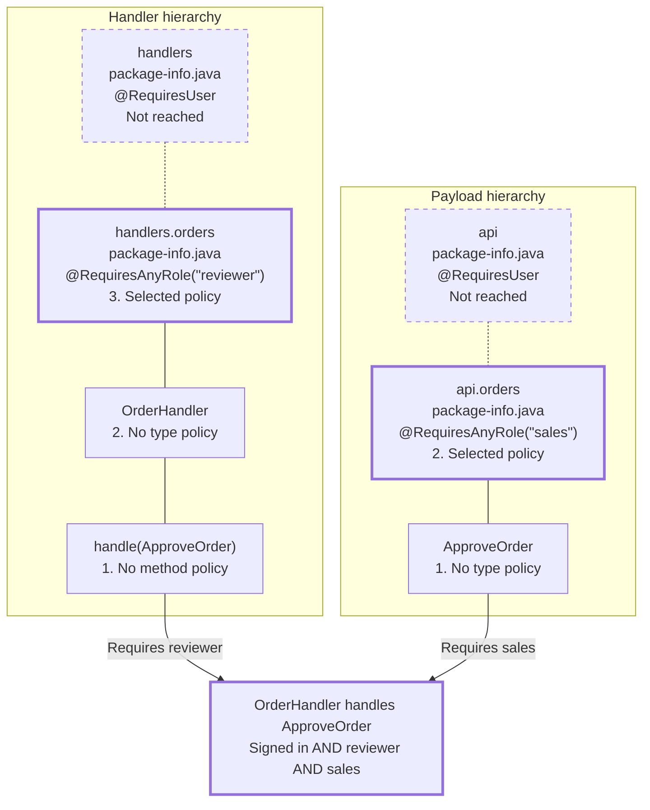
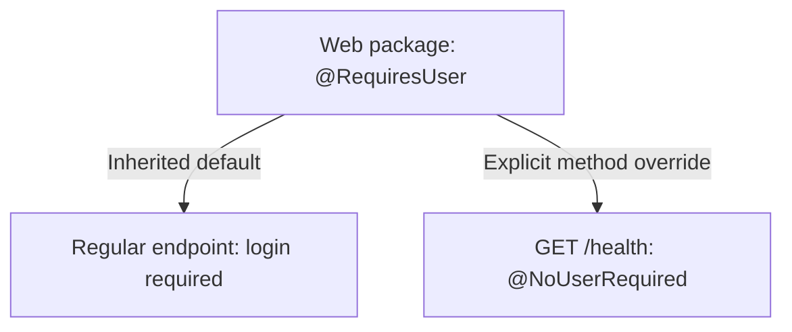

import { Tabs, TabItem } from '@astrojs/starlight/components';
import { Aside } from '@astrojs/starlight/components';

Fluxzero allows you to restrict message handling based on the authenticated user's roles. This access control happens **before** the message reaches the handler — similar to how payload validation is enforced.

There are several annotations for declaring user and role requirements.

## @RequiresAnyRole

Use this annotation to ensure that a handler is only invoked if the user has **at least one** of the specified roles.

<Tabs>
<TabItem value="Java" label="Java">

```java
@HandleCommand
@RequiresAnyRole({"admin", "editor"})
void handle(UpdateArticle command) { ... }
```

```java
@RequiresAnyRole("admin")
public record DeleteAccount(String userId) {
}
```

</TabItem>
<TabItem value="Kotlin" label="Kotlin">

```kotlin
@HandleCommand
@RequiresAnyRole(["admin", "editor"])
fun handle(command: UpdateArticle) { ... }
```

```kotlin
@RequiresAnyRole("admin")
data class DeleteAccount(val userId: String)
```

</TabItem>
</Tabs>

<Aside type="tip">
    You can use enum-based roles too. See how [here](#enum-based-role-annotations).
</Aside>

## @ForbidsAnyRole

This annotation **prevents** message handling if the user has any of the specified roles. With a nonempty role list, the default throwing policy also rejects an absent user with `UnauthenticatedException`. An empty list allows every authenticated user and silently skips anonymous users regardless of `throwIfUnauthorized`.

<Tabs>
<TabItem value="Java" label="Java">

```java
@ForbidsAnyRole("guest")
@HandleCommand
void handle(SensitiveOperation command) { ... }
```

</TabItem>
<TabItem value="Kotlin" label="Kotlin">

```kotlin
@ForbidsAnyRole("guest")
@HandleCommand
fun handle(command: SensitiveOperation) { ... }
```

</TabItem>
</Tabs>

## @RequiresUser

Ensures that a message can only be handled if an **authenticated user** is present. If no user is found, the message is rejected with an `UnauthenticatedException`.

<Tabs>
<TabItem value="Java" label="Java">

```java
@RequiresUser
@HandleCommand
void handle(UpdateProfile command) { ... }
```

</TabItem>
<TabItem value="Kotlin" label="Kotlin">

```kotlin
@RequiresUser
@HandleCommand
fun handle(command: UpdateProfile) { ... }
```

</TabItem>
</Tabs>

## @NoUserRequired

Allows a message to be processed even if **no authenticated user** is present — ideal for public APIs or health checks.

<Tabs>
<TabItem value="Java" label="Java">

```java
@NoUserRequired
@HandleCommand
void handle(SignUpUser command) { ... }
```

</TabItem>
<TabItem value="Kotlin" label="Kotlin">

```kotlin
@NoUserRequired
@HandleCommand
fun handle(command: SignUpUser) { ... }
```

</TabItem>
</Tabs>

## @ForbidsUser

Prevents message handling if an **authenticated user is present**. This is useful for restricting certain flows to unauthenticated users — such as guest signups.

<Tabs>
<TabItem value="Java" label="Java">

```java
@ForbidsUser
@HandleCommand
void handle(SignUpAsGuest command) { ... }
```

</TabItem>
<TabItem value="Kotlin" label="Kotlin">

```kotlin
@ForbidsUser
@HandleCommand
fun handle(command: SignUpAsGuest) { ... }
```

</TabItem>
</Tabs>

---

## Controlling behavior on unauthorized access

Keep the default throwing behavior for ordinary access restrictions:

- If a user is required but not present, an `UnauthenticatedException` is thrown.
- If a user is present but lacks the required access, an `UnauthorizedException` is thrown.

With `throwIfUnauthorized = false`, a denied handler is skipped instead of throwing. Other eligible handlers can still process the request. On a command or query payload, denial skips every handler for that payload. A skipped request does not produce a successful `null` response; if no handler responds, the caller may eventually time out.

Authorization is evaluated for the current request's user, including when handlers are prepared for reuse. For a query whose result varies by role, one authenticated handler with an explicit role branch is often the clearest option.

---

## Role annotations support nesting and overrides

You can protect a command or query and the handler that processes it. For a separate command/query handler, **both checks must allow access**. Making one side public does not remove a requirement on the other side. These examples use the default throwing behavior on denial.

Consider `OrderHandler.handle(ApproveOrder)`. Both types have their own package hierarchy. Read each column **from the method or type up toward its parent packages**: the search stops at the nearest authorization policy. Package names below are relative to `com.example`.



The package policies with a heavy solid border are selected; the dashed parent policies are not added to them. The handler requires `reviewer` and the payload requires `sales`, so a signed-in user needs **both roles**. Within one hierarchy the nearest policy wins; **between payload and handler the two checks are combined with AND**. If one policy lists several roles in `@RequiresAnyRole`, satisfying any one of those roles passes that check; the other check must still pass independently.

### Choosing the policy on each side

Use the first level with authorization annotations in each row. Each side uses its **own** type and package hierarchy.

| Check | Search order |
| --- | --- |
| Command or query | Payload type → own package → parent packages |
| Handler | Handler method → handler type → own package → parent packages |

Packages provide defaults. A subpackage with authorization annotations replaces the broader package policy; requirements declared together at the selected level still apply together. Unrelated annotations do not stop the search. If no level defines authorization, that side allows access.

### A public healthcheck in a protected package

Suppose the web handlers live in a package annotated with `@RequiresUser`. Regular endpoints inherit that requirement. The healthcheck explicitly uses `@NoUserRequired`, so a monitoring probe can call it without logging in.



In Java, declare the default in `com/myapp/web/package-info.java`:

```java
@RequiresUser
package com.myapp.web;

import io.fluxzero.sdk.tracking.handling.authentication.RequiresUser;
```

Then allow anonymous requests on the healthcheck method. In a Kotlin-only project, a class-level default provides the same method-override pattern:

<Tabs>
<TabItem value="Java" label="Java">

```java
package com.myapp.web;

import io.fluxzero.sdk.tracking.handling.authentication.NoUserRequired;
import io.fluxzero.sdk.web.HandleGet;

public class HealthEndpoint {
    @HandleGet("/health")
    @NoUserRequired
    public String health() {
        return "OK";
    }
}
```

</TabItem>
<TabItem value="Kotlin" label="Kotlin">

```kotlin
package com.myapp.web

import io.fluxzero.sdk.tracking.handling.authentication.NoUserRequired
import io.fluxzero.sdk.tracking.handling.authentication.RequiresUser
import io.fluxzero.sdk.web.HandleGet

@RequiresUser
class HealthEndpoint {
    @HandleGet("/health")
    @NoUserRequired
    fun health(): String = "OK"
}
```

</TabItem>
</Tabs>

This exception applies to the healthcheck handler. It does not grant anonymous access to protected commands or queries sent by that handler.

### Type inheritance and shared packages

Type policy includes inherited type and interface annotations. Different authorization annotations inherited this way can coexist; the table describes fallback between levels, not replacement of individual inherited annotations.

When multiple JARs define `package-info` for the same package, the first definition selected by the classloader supplies that package's policy. Other definitions of that same package are not combined. This policy applies to classes from every JAR in that package; the application controls precedence through its packaging and classloader configuration. Ancestor authorization packages use the defining loader of the payload or handler class, including applications loaded below the SDK's loader. Changing the thread context loader does not change that policy.

---

## Enum-based role annotations

You can define custom annotations using enums for structured roles.

<Tabs>
<TabItem value="Java" label="Java">

```java
public enum Role {
    ADMIN, EDITOR, USER
}

@RequiresAnyRole
@Target({ElementType.TYPE, ElementType.METHOD})
public @interface RequiresRole {
    Role[] value();
}
```

```java
@HandleCommand
@RequiresRole(Role.ADMIN)
void handle(DeleteAccount command) { ... }
```

</TabItem>
<TabItem value="Kotlin" label="Kotlin">

```kotlin
enum class Role {
    ADMIN, EDITOR, USER
}

@RequiresAnyRole
@Target(AnnotationTarget.CLASS, AnnotationTarget.FUNCTION)
annotation class RequiresRole(val value: Array<Role>)
```

```kotlin
@HandleCommand
@RequiresRole([Role.ADMIN])
fun handle(command: DeleteAccount) { ... }
```

</TabItem>
</Tabs>

---

## Best practices

- Put shared requirements on **command and query types** so their handlers respect the operation's access policy.
- Apply **handler** annotations for additional requirements or explicit exceptions to handler package defaults.
- Set **default access rules at the package level**, and override them as needed.
- Create **custom annotations** to avoid repeating role strings throughout your codebase.

---

<Aside type="tip">
  Access control is enforced before the handler runs. There’s no need to log user context or payload — Fluxzero maintains full correlation in logs, errors, and audit trails automatically.
</Aside>

---

## Where does user info come from?

User roles are resolved by the configured `UserProvider`, which extracts user info from message metadata (e.g. headers or tokens). Fluxzero uses a pluggable SPI to register this provider.

Use `User.id()` for ownership checks, audit references, and other behavior that needs a stable user identity. In the 1.x
SDK it defaults to `Principal.getName()` for compatibility with existing `User` implementations. Override `id()` when
the principal name is a display or provider-facing name. `AbstractUserProvider` stores this ID in user metadata and
resolves it through `getUserById(...)`; keep accepting earlier `getName()` values while older messages can still be in
flight.

<Aside type="tip">
  In tests, you can override or mock the <code>UserProvider</code> via the <code>TestFixture</code> API.
</Aside>

---

## Providing your own user logic

You can implement a custom `UserProvider` to extract users from headers, JWT tokens, cookies, etc.

<Tabs>
<TabItem value="Java" label="Java">

```java
public class MyUserProvider extends AbstractUserProvider {
    public MyUserProvider() {
        super("Authorization", MyUser.class);
    }

    @Override
    public User fromMessage(HasMessage message) {
        if (message.toMessage() instanceof WebRequest request) {
            return decodeToken(request.getHeader("Authorization"));
        }
        return super.fromMessage(message);
    }

    private User decodeToken(String header) {
        // Parse and validate JWT token here
        return ...;
    }
}
```

</TabItem>
<TabItem value="Kotlin" label="Kotlin">

```kotlin
class MyUserProvider : AbstractUserProvider("Authorization", MyUser::class.java) {
    override fun fromMessage(message: HasMessage): User {
        val request = message.toMessage() as? WebRequest
        return request?.getHeader("Authorization")?.let { decodeToken(it) } ?: super.fromMessage(message)
    }

    private fun decodeToken(header: String): User {
        // Your decoding logic here
        return ...
    }
}
```

</TabItem>
</Tabs>

---

## System and testing support

Your `UserProvider` can also implement:

- `getSystemUser()` — returns the default **system-level user** (used in tests and scheduled handlers)
- `getUserById(...)` — used by test utilities like `fixture.whenCommandByUser(...)`

This ensures consistent behavior across environments.

---

## Registering your user provider

To register your custom `UserProvider`, use Java's SPI mechanism:

```
src/main/resources/META-INF/services/io.fluxzero.sdk.tracking.handling.authentication.UserProvider
```

Add each provider class (one per line):

```
com
