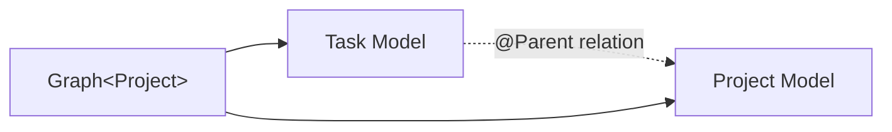

import { Tabs, TabItem, Aside } from '@astrojs/starlight/components';

Fluxzero stores domain objects as independently addressable Models. A Graph reads a Model and its related Models at
one boundary. For the other state mechanisms, see
[State in Fluxzero](/docs/guides/modeling-and-persistence/state-in-fluxzero).

## Why Models are independent

Each Model has its own identity, state, storage and lifecycle. A Task and Project can therefore be separate Models.
An `@Parent` relation connects them without merging their storage or lifecycles. Updating or deleting the Task does
not rewrite the Project or its other Tasks.

Changing the relation can move the Task without changing its identity. One Model action can still update several
Models atomically.

## What a Graph adds

A Graph is a connected view of Models at one read boundary. Starting from a Project, you can follow its Tasks. Starting
from a Task, you can find its Project. The Graph keeps those reads consistent with one another, including when you
inspect an earlier state.



The Models remain independently addressable. Use a Graph when a read depends on related Models or their state at an
earlier boundary.

<Aside type="note" title="A Graph is a view, not another domain object">
Fluxzero does not persist a Graph as domain state. Model updates change the underlying Models. Graph branches load
lazily, so creating a Graph does not fetch every related Model.
</Aside>

## How Models become a Graph

Give each Model a typed identity. On the child, `@Parent` declares the relationship and `pathInParent` gives that
relationship a name when navigating from the parent:

<Tabs>
  <TabItem label="Java">

```java
@Model
record Project(@EntityId ProjectId projectId, ProjectDetails details) {}

@Model
record Task(
        @EntityId TaskId taskId,
        @Parent(pathInParent = "tasks") ProjectId projectId,
        TaskDetails details,
        boolean completed) {}

final class ProjectId extends Id<Project> {
    ProjectId(String value) { super(value); }
}

final class TaskId extends Id<Task> {
    TaskId(String value) { super(value); }
}
```

  </TabItem>
  <TabItem label="Kotlin">

```kotlin
@Model
data class Project(@EntityId val projectId: ProjectId, val details: ProjectDetails)

@Model
data class Task(
    @EntityId val taskId: TaskId,
    @Parent(pathInParent = "tasks") val projectId: ProjectId,
    val details: TaskDetails,
    val completed: Boolean
)

class ProjectId(value: String) : Id<Project>(value)
class TaskId(value: String) : Id<Task>(value)
```

  </TabItem>
</Tabs>

`ProjectDetails` and `TaskDetails` are ordinary immutable value objects. Their role is to keep descriptive fields,
such as a name or title, together according to their domain meaning. Their declarations are omitted here because they
have no independent lifecycle and add nothing to the Model–Graph relationship shown in this example.

`@Parent` records a Graph relation. The `Task` is still stored and loaded as its own Model; the Project does not need a
`List<Task>` field.

Create each Model through a small action:

<Tabs>
  <TabItem label="Java">

```java
record CreateProject(ProjectId projectId, ProjectDetails details) {
    @Apply Project apply() {
        return new Project(projectId, details);
    }
}

record AddTask(TaskId taskId, ProjectId projectId, TaskDetails details) {
    @Apply Task apply(Project project) {
        return new Task(taskId, project.projectId(), details, false);
    }
}
```

  </TabItem>
  <TabItem label="Kotlin">

```kotlin
data class CreateProject(val projectId: ProjectId, val details: ProjectDetails) {
    @Apply fun apply() = Project(projectId, details)
}

data class AddTask(val taskId: TaskId, val projectId: ProjectId, val details: TaskDetails) {
    @Apply fun apply(project: Project) = Task(taskId, project.projectId, details, false)
}
```

  </TabItem>
</Tabs>

The `Project` parameter makes adding a Task depend on an existing Project. After sending both actions, load the Project
Graph and follow the named relation:

<Tabs>
  <TabItem label="Java">

```java
ProjectId projectId = new ProjectId("website");
TaskId taskId = new TaskId("write-homepage");

Fluxzero.sendCommandAndWait(new CreateProject(projectId, new ProjectDetails("Website")));
Fluxzero.sendCommandAndWait(new AddTask(taskId, projectId, new TaskDetails("Write the homepage")));

Graph<Project> project = Fluxzero.loadGraph(projectId);
List<Task> tasks = project.childModels("tasks", Task.class);
```

  </TabItem>
  <TabItem label="Kotlin">

```kotlin
val projectId = ProjectId("website")
val taskId = TaskId("write-homepage")

Fluxzero.sendCommandAndWait<Any?>(CreateProject(projectId, ProjectDetails("Website")))
Fluxzero.sendCommandAndWait<Any?>(AddTask(taskId, projectId, TaskDetails("Write the homepage")))

val project: Graph<Project> = Fluxzero.loadGraph(projectId)
val tasks: List<Task> = project.childModels("tasks", Task::class.java)
```

  </TabItem>
</Tabs>

`tasks` now contains the Task, while `Fluxzero.loadModel(taskId)` can still load that same Task directly.

## Choose the boundary by lifecycle

Make something a separate Model when it has its own creation, changes, history, retention or deletion. Use an ordinary
value object when it changes only as part of its owner. Use `@Member` when the complete lifecycle deliberately belongs
to one containing root.

Object shape is not the deciding factor. A small status can deserve its own Model; a large details object can remain a
value. Ask who owns its lifecycle before choosing how convenient it is to embed.

Continue with:

- [Loading Models](/docs/guides/modeling-and-persistence/entity-loading) to choose a direct Model or connected Graph read.
- [Updating Models](/docs/guides/modeling-and-persistence/updating-entities) to create, change and delete state.
- [Model relations and embedded members](/docs/guides/modeling-and-persistence/nested-entities) to design ownership and movement.
- [Temporal Graphs](/docs/guides/modeling-and-persistence/temporal-graphs) to inspect related state at an earlier boundary.
